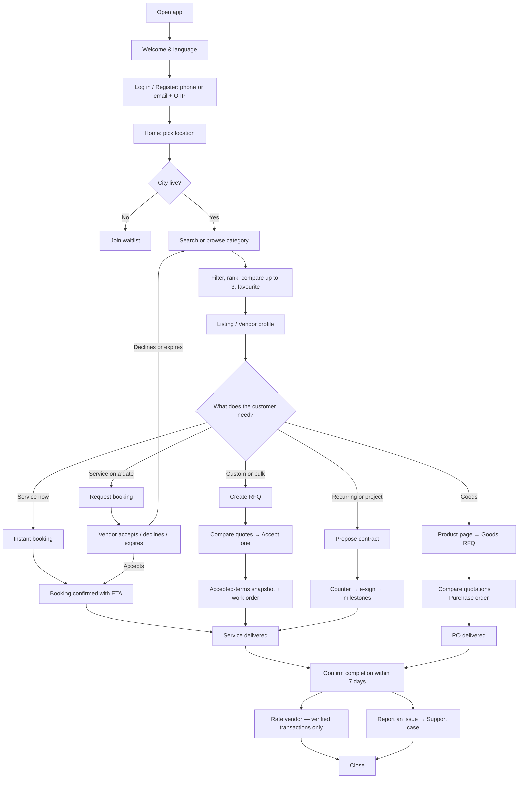
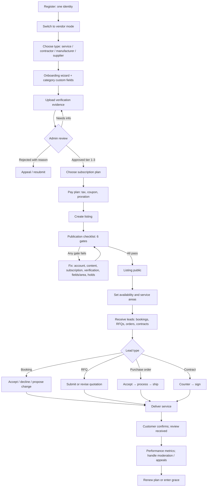
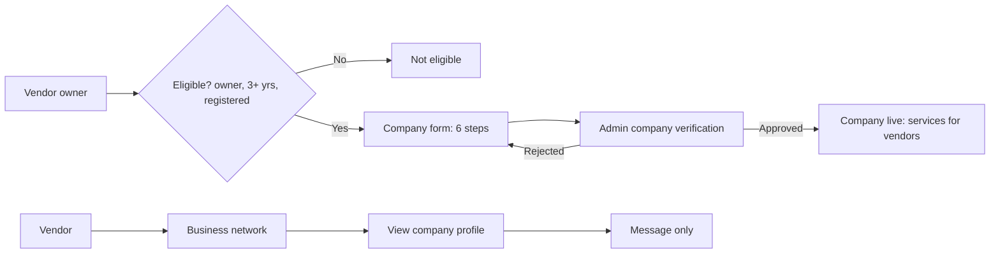
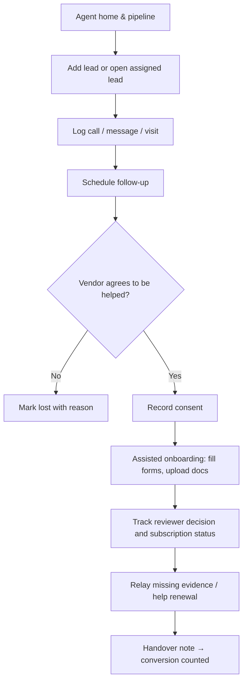
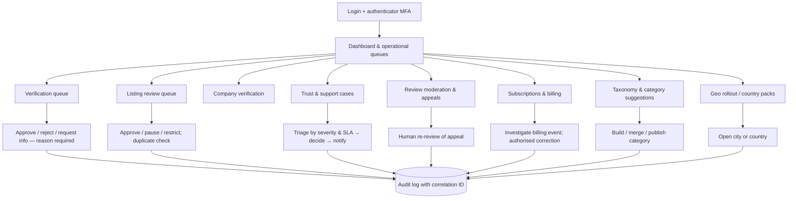

# 04 · Customer, Vendor, Agent and Admin Flowcharts

Diagrams use Mermaid (renders on GitHub, VS Code preview, and most docs tools). Screen IDs in brackets match `docs/screen-inventory.csv`.

## 1. Customer

**Side flows:** suggest a category · modify or cancel a booking · edit RFQ (revision) · profile (individual/business) · notification and privacy settings · delete account request.

## 2. Vendor

**Side flows:** sponsored visibility · business network (message a verified company) · buyer mode for vendor-to-vendor procurement · credential expiry reminders.

## 3. Business (company) account

## 4. Sales agent

**Hard limits:** agent cannot approve or reject verification, publish or edit listings, touch billing/refunds, read customer transactions or chats, or see other agents' leads.

## 5. Admin (staff)

**Rules:** self-approval blocked (separation of duties); every high-impact action captures a reason; RBAC scopes per staff role; admin sessions require MFA.
