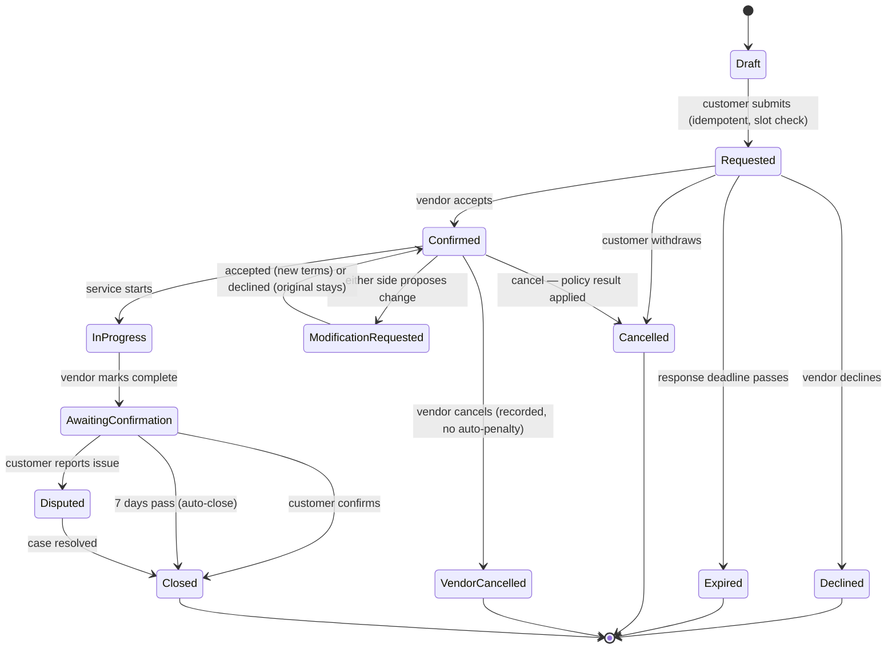
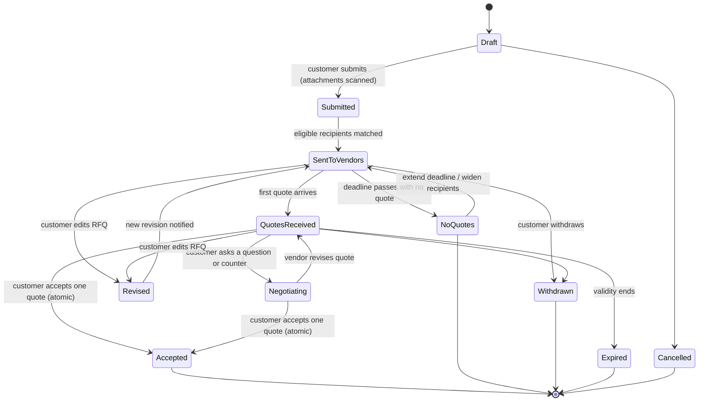
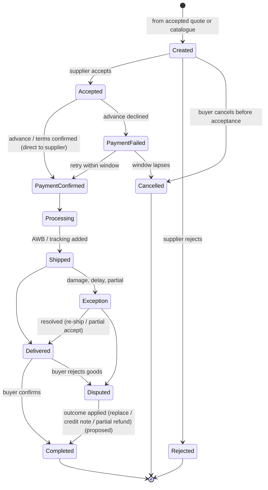
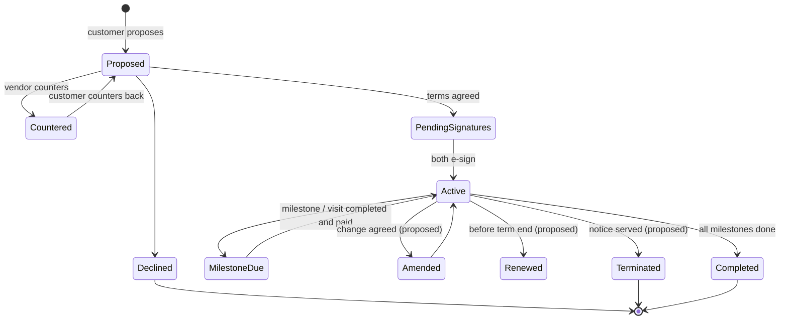
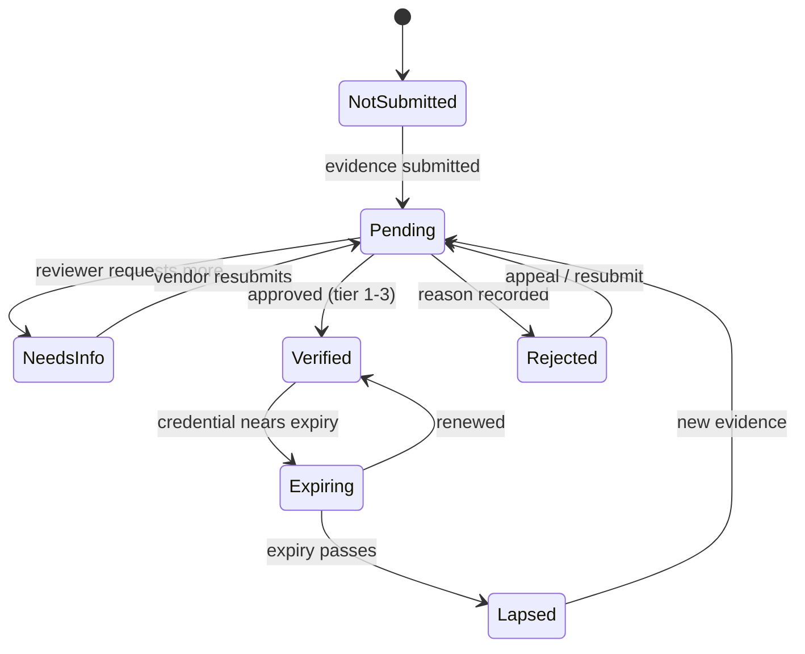
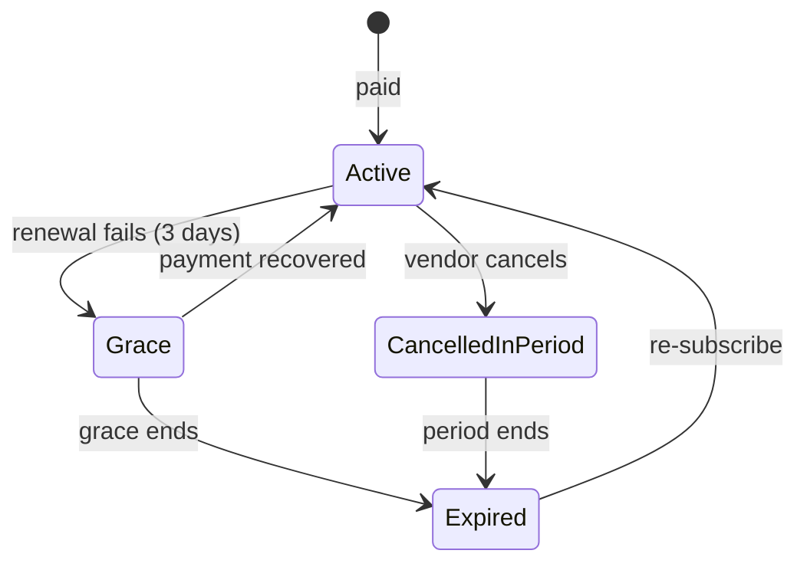
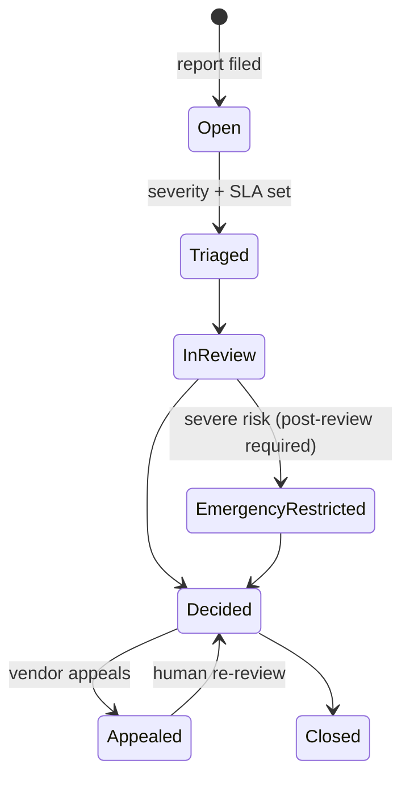

# 05 · Booking, RFQ and Order State Diagrams

> **Detail document, not yet reviewed against the 2026-10-29 decisions** (see [../../../docs/04-decisions-log.md](../../../docs/04-decisions-log.md)). Phase labels follow the spec in [../../../docs/01-feature-spec.md](../../../docs/01-feature-spec.md) where they differ.

States come from the mockup code (`BK_LABEL` in `src/screens/shared.jsx`, `PO_FLOW`/`rfqStatus` in `src/mvpdata.jsx`). Items marked **(proposed)** are not yet in the mockup and are needed for production.

## 1. Booking

**Rules**
- Terms are snapshotted at confirmation. A modification never changes them until accepted.
- Two simultaneous confirmations for one slot → "conflicting confirmations" chooser; one wins atomically.
- Instant booking skips *Requested*: slot is locked and the booking is created as *Confirmed* with an ETA.
- Reviews are enabled only from *Closed* with a completed transaction.
- A support case can be linked to a closed booking.

## 2. RFQ

**Quote sub-states:** `submitted → revised → withdrawn | expired | accepted | not_selected`.

**Rules**
- Accept is atomic: if two accepts race, exactly one wins; the others receive "not selected".
- Accepting creates an immutable **accepted-terms snapshot** plus a downstream record:
  - service RFQ → **work order** (or booking),
  - goods RFQ → **purchase order**,
  - recurring/project → **contract**.
- Editing an RFQ creates a revision; vendors with open quotes are notified and may revise.

## 3. Purchase order (goods)

## 4. Contract (recurring, AMC, supply, project)

## 5. Vendor verification and listing publication

A listing is **public only if all six gates pass**, computed live: account state · content review · subscription (active/grace/cancelled-in-period) · required verification (per-credential expiry) · required fields + service area · no holds.

## 6. Subscription

## 7. Support case

## Change Log

| Date & time (YYYY-MM-DD HH:MM, local) | Updated by | Change | Reason |
|---|---|---|---|
| 2026-10-29 16:27 | Shil1517 | Modified: added pointer banner | Added pointer to the new docs/ set; content review still outstanding |
