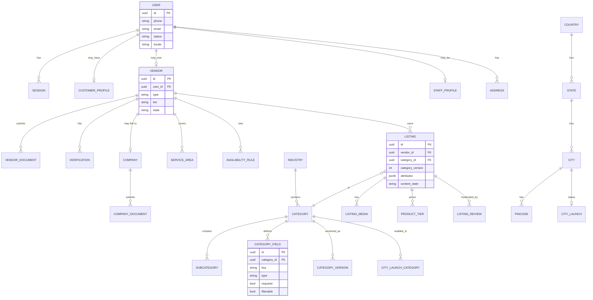
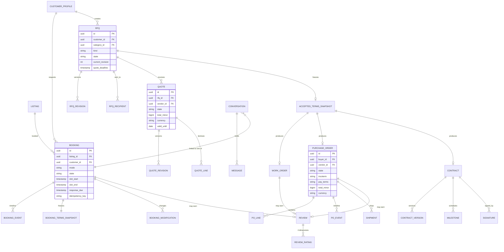
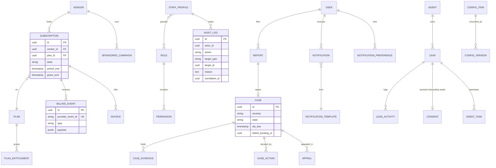

# 06 · Proposed Database Architecture / ERD

> **Detail document, not yet reviewed against the 2026-10-29 decisions** (see [../../../docs/04-decisions-log.md](../../../docs/04-decisions-log.md)). Phase labels follow the spec in [../../../docs/01-feature-spec.md](../../../docs/01-feature-spec.md) where they differ.

## 1. Architecture choices

| Concern | Choice | Why |
|---|---|---|
| Primary store | **PostgreSQL 16** | Strong relational integrity for bookings/quotes/billing; JSONB for category attributes; row-level locking for atomic accept and slot booking. |
| Geo | PostGIS | Service-area and pincode/radius matching. |
| Search | OpenSearch / Elasticsearch (read model) | Filters on dynamic attributes, geo, ranking. Fed from Postgres via outbox events. |
| Cache / queues | Redis | OTP, rate limits, sessions, deadline timers, job queues. |
| Files | S3-compatible object storage + virus scan | Evidence, listing media, RFQ attachments, invoices. |
| Analytics | Event stream → warehouse (later) | Keeps reporting load off OLTP. |
| Audit | Append-only table, partitioned monthly | Immutable trail with correlation IDs. |

**Principles**
1. **Config over code.** Categories, attribute schemas, plans, policies and country packs are versioned rows.
2. **Computed publication.** `listing.is_public` is never stored; it is derived from the six gates (use a SQL view / service, plus a denormalised search flag updated by events).
3. **Snapshots are immutable.** Accepted terms, booking terms and contract versions are copied into snapshot rows.
4. **One identity, many modes.** A `user` may have customer, vendor, business and staff profiles; mode is not a privilege.
5. **Soft delete + anonymise** for DPDP-style deletion; financial and audit records retained per law.
6. **Money** as integer minor units + ISO currency code. No floats.
7. Every table: `id` (UUIDv7), `created_at`, `updated_at`; tenant-like scoping by `country_code` where relevant.

## 2. ERD — identity, vendors and listings

## 3. ERD — transactions

## 4. ERD — trust, billing and operations

## 5. Phase 2 additions (not in MVP schema)

`PAYMENT`, `ESCROW_HOLD`, `PAYOUT`, `COMMISSION_RULE`, `WALLET`, `WALLET_TXN`, `REFUND`, `BANK_ACCOUNT`, `TEAM_MEMBER`, `SAMPLE_REQUEST`, `TRADE_DOCUMENT`, `COUNTRY_PACK`, `CREDIT_NOTE`.

## 6. Key constraints and invariants

| Rule | Mechanism |
|---|---|
| One winning quote per RFQ | `UNIQUE (rfq_id) WHERE state='accepted'` + `SELECT … FOR UPDATE` on RFQ in accept transaction |
| No double-booked slot | Exclusion constraint on `(listing_id, tstzrange(slot_start, slot_end))` where state in (confirmed, in_progress) |
| Idempotent booking create | `UNIQUE (customer_id, idempotency_key)` |
| Idempotent billing webhooks | `UNIQUE (provider_event_id)` |
| Review only after eligible transaction | FK to closed booking/PO/work order + unique per transaction per reviewer |
| Contact details hidden pre-confirmation | Application policy + column-level access; messages scanned |
| Admin self-approval blocked | Check `actor_id <> subject.owner_id` and separation-of-duties rule in service |
| Audit immutability | No UPDATE/DELETE grants on `audit_log` |
| Money precision | `bigint` minor units, `char(3)` currency |

## 7. Index and scale notes

- Search is served by the search index, not Postgres. Keep Postgres indexes for owner lookups (`vendor_id`, `customer_id`, `state`, `created_at`).
- Partition `audit_log`, `message`, `notification`, `booking_event` by month.
- Category attributes in `listing.attributes` (JSONB) with GIN index for admin tooling; filter queries go to the search index.
- Read replicas for dashboards and exports from MVP+3 months.

## 8. Retention

| Data | Retention |
|---|---|
| Audit log, invoices, billing events | 8 years (tax) |
| Messages linked to a case | Until case closed + 2 years |
| Messages otherwise | 2 years after transaction close |
| Verification evidence | While vendor active + 1 year |
| Deleted user PII | Anonymised within 30 days of request unless legal hold |

## Change Log

| Date & time (YYYY-MM-DD HH:MM, local) | Updated by | Change | Reason |
|---|---|---|---|
| 2026-10-29 16:27 | Shil1517 | Modified: added pointer banner | Added pointer to the new docs/ set; content review still outstanding |
